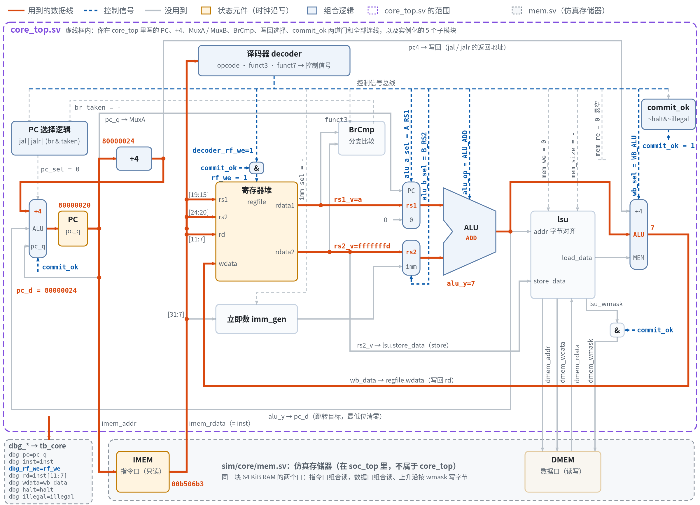

# mycore：手写 RV32I 处理器核


> **English summary.** A hand-written RV32I processor core in SystemVerilog, built step by step from a single-cycle design toward a 5-stage pipeline. The single-cycle core is complete: it executes all 40 RV32I base instructions, passes randomized differential unit tests for every module and five whole-core test programs (including a compiled C program), is lint-clean under `verilator -Wall`, and is synthesized with Yosys to track area and logic depth. **This project is under active development**; next steps are riscv-tests, a DiffTest reference model, and the 5-stage pipeline with forwarding and hazard handling.

**状态：持续开发中。** 单周期核已完成（2026-10-23），正在推进验证基础设施和五级流水。进度见下面的[路线图](#路线图)，最后更新：2026-10-23。

作者：罗文轩，中国科学院大学电子信息专业在读硕士研究生。

## 项目简介

从零手写一个 RISC-V 处理器核，目标是做出一个能跑官方测试集和 CoreMark 的 RV32I 五级流水核，并能在 FPGA 上运行。项目按“先单周期、再验证、再流水线”的顺序推进，每个模块都要过四道关：

1. **对拍测试**：随机激励加参考模型逐拍比对，每个模块十万到百万级用例。
2. **随机初值**：用 Verilator 的随机复位值检查电路是否依赖“上电为 0”。
3. **lint 零警告**：`verilator --lint-only -Wall`。
4. **综合**：Yosys 综合，记录单元数和最长逻辑深度，用数字评估面积和时序。

## 当前成果（单周期核）

| 项目 | 结果 |
|---|---|
| 指令集 | RV32I 全部 40 条基础指令；非法编码（保留 opcode、未定义 funct3/funct7、M 扩展、CSR 等）检测为 illegal |
| 单元测试 | 6 组全部通过：ALU 201,960 例，寄存器堆 100,036 例（含随机初值），立即数生成 1,000,178 例，译码器 310,666 例（覆盖 40 条指令），访存单元 200,020 例 |
| 整核测试 | 5 个程序全部通过：算术逻辑、分支跳转、字节/半字访存、C 程序 hello、C 程序 sum（1+…+100，循环在核上真实执行） |
| lint | 6 个模块 `-Wall` 零警告 |
| 综合（Yosys，`-noabc`） | 整核 6,282 单元、1,024 个触发器、最长逻辑深度 59 |

各模块综合数据：

| 模块 | 文件 | 单元数 | 最长深度 | 说明 |
|---|---|---:|---:|---|
| ALU | `rtl/alu.sv` | 1,454 | 27 | 10 种运算，SUB/SLT/SLTU 共用一个加法器 |
| 寄存器堆 | `rtl/regfile.sv` | 3,072 | 6 | 只建 x1～x31（992 个触发器），x0 读写两端都挡住 |
| 立即数生成 | `rtl/imm_gen.sv` | 224 | 9 | I/S/B/U/J 五种格式 |
| 译码器 | `rtl/decoder.sv` | 311 | 16 | 三层判断 opcode → funct3 → funct7，含非法指令检测 |
| 访存单元 | `rtl/lsu.sv` | 483 | 10 | 字节/半字对齐、符号与零扩展、字节写使能 |
| 顶层 | `rtl/core_top.sv` | 6,282 | 59 | 数据通路连线、分支比较、下一 PC、提交门控 |

## 微架构



单周期数据通路，图中以 `add a3, a0, a1` 为例：橙色是这条指令用到的数据线，蓝色虚线是控制信号，灰色是没用到的通路。紫色虚线框内是 `core_top.sv`，下方灰框是核外的仿真存储器（同一块 64 KiB RAM 的指令口和数据口）。图中信号名和 RTL 一致。

几个设计决策：

- **跳转目标统一由 ALU 计算**（分支、jal 算 PC + imm，jalr 算 rs1 + imm），分支条件由独立的比较器 BrCmp 判断，下一 PC 只需要二选一。
- **jalr 目标清最低位**统一写成 `{alu_y[31:1], 1'b0}`。B/J 型立即数最低位恒为 0，对分支和 jal 是空操作，硬件上只是一根线接常数 0。
- **两层写保护**：译码器在非法指令时关闭写使能；顶层再用 `commit_ok = ~halt & ~illegal` 门控寄存器堆写使能、存储器字节写使能，并冻结 PC。
- **控制信号用枚举类型**（`core_pkg.sv`），编码集中定义，类型不匹配在 lint 阶段报错。
- **存储器在核外**：`core_top` 只暴露指令口和数据口，仿真时接 `sim/core/mem.sv`（64 KiB，组合读、按字节写），上板时换成 BRAM。

## 目录结构

```
mycore/
├── rtl/                  处理器 RTL（手写）
│   ├── core_pkg.sv       控制信号枚举类型
│   ├── alu.sv  regfile.sv  imm_gen.sv  decoder.sv  lsu.sv
│   └── core_top.sv       单周期顶层
├── sim/
│   ├── unit/             各模块的随机对拍测试平台（C++）
│   ├── core/             整核仿真：存储器模型、soc_top、测试平台、hex 转换脚本
│   └── smoke/            工具链冒烟测试
├── sw/
│   ├── tests/            汇编测试程序 t1_alu / t2_branch / t3_mem
│   ├── hello/  sum/      C 测试程序与链接脚本
│   └── common/           仿真用启动代码
└── Makefile
```

## 快速开始

依赖：

- Verilator 5.x（开发使用 5.052）和 g++
- RISC-V GCC 工具链，前缀默认 `riscv64-unknown-elf-`（`-march=rv32i -mabi=ilp32`），可用 `RISCV_PREFIX=` 覆盖
- Python 3
- 综合可选：带 slang 前端的 Yosys（开发使用 `yowasp-yosys` 0.69）

```bash
make test-unit                    # 6 组模块单元测试
make test-core                    # 编译整核并跑 5 个测试程序
make run PROG=sum TRACE=1         # 跑单个程序，逐条打印 PC、指令、写回值
make lint                         # verilator -Wall
make synth SYNTH_TOP=core_top     # Yosys 综合，输出单元数与最长深度
```

`TRACE=1` 的输出示例（t1_alu 前几条）：

```
     0  pc=80000000  inst=01400293  t0   <- 00000014
     1  pc=80000004  inst=ff900313  t1   <- fffffff9
     2  pc=80000008  inst=006283b3  t2   <- 0000000d
     ...
CORE: ebreak，共 25 条指令，停在 pc=80000064 inst=00100073，a0 = 0000002a (42)，期望 a0 = 0000002a -> PASS
```

## 路线图

- [x] **阶段 1：单周期核**（2026-10-05 ～ 10-23）
  - [x] ALU、寄存器堆（L3）
  - [x] 立即数生成、译码器（L4）
  - [x] 访存单元、单周期顶层，整核跑通 C 程序（L5）
- [ ] **阶段 2：验证基础设施**（计划至 2026-11-02）
  - [ ] FST 波形与调试流程（L6）
  - [ ] 接入官方 riscv-tests（rv32ui）（L7）
  - [ ] DiffTest：C 参考模型逐条比对 PC 和寄存器，itrace（L8）
- [ ] **阶段 3：五级流水**（计划至 2026-11-16）
  - [ ] IF/ID/EX/MEM/WB 流水线寄存器（L9、L10）
  - [ ] EX/MEM、MEM/WB 前递，load-use 停顿（L11）
  - [ ] 分支冲刷（L12）
  - [ ] 回归测试与性能计数器（L13）
- [ ] **阶段 4：性能与上板**（计划至 2026-11-30）
  - [ ] CoreMark 与 CPI 分析（L14）
  - [ ] Vivado 综合，Zynq-7015 上板，最高频率与关键路径（L15）
  - [ ] 对照阅读 CVA6，写对比笔记（L16）
- [ ] 后续可选：M 扩展、分支预测、指令 Cache、AXI 接口、CSR 与中断

## 参考资料

- [RISC-V 非特权指令集规范](https://riscv.org/technical/specifications/)
- [一生一芯](https://ysyx.oscc.cc/)（DiffTest、trace 等方法论）
- David Patterson、Andrew Waterman，《RISC-V 开放架构设计之道》
- [lowRISC SystemVerilog 编码规范](https://github.com/lowRISC/style-guides/blob/master/VerilogCodingStyle.md)
- [CVA6](https://github.com/openhwgroup/cva6)
